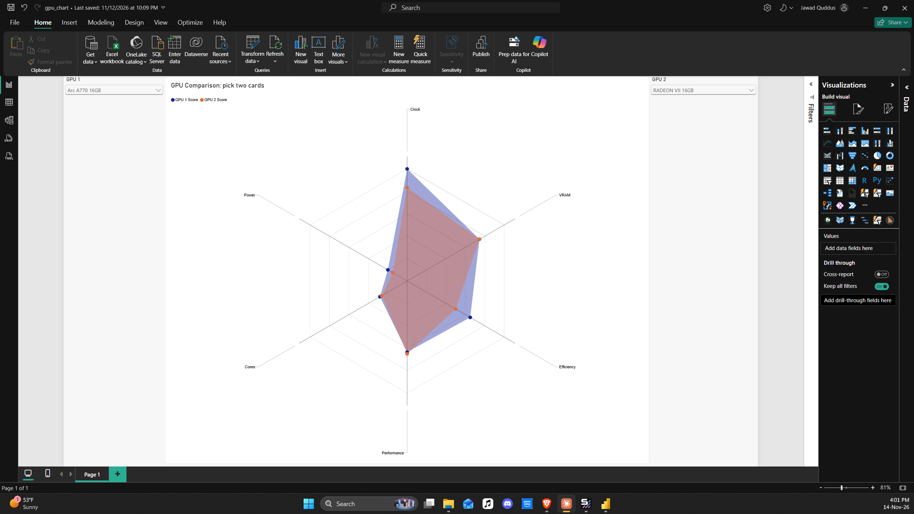

# gpu-comparison-tool

Pick any two graphics cards and compare them on six axes in a radar chart. Built in Excel and Power BI from a dataset of 133 GPUs released between 2002 and 2025, covering NVIDIA, AMD and Intel.

## What it does

Two dropdowns (GPU 1 and GPU 2) feed a radar chart. Choose two cards and the chart redraws with both shapes overlaid, so you can see where one card beats the other.

## The six axes

Every axis is scaled from 0 to 100 so they can share one chart.

| Axis | How it is calculated |
|---|---|
| Performance | PassMark G3D Mark divided by 39,023 (the RTX 5090 score), times 100 |
| VRAM | Card VRAM divided by the highest VRAM in the dataset, times 100 |
| Cores | Core count divided by the highest core count, times 100 |
| Clock | Core clock speed divided by the highest clock speed, times 100 |
| Efficiency | Performance per watt (score divided by TDP), divided by the best in the dataset, times 100 |
| Power | Lowest TDP in the dataset divided by the card's TDP, times 100. A lower power draw scores higher |

## Data

- **Source for performance:** PassMark G3D Mark (crowdsourced averages). The RTX 5090 is the control at 100.
- **Specs:** VRAM, core count, clock speed, TDP and release year were collected by hand for each card.
- **Cleaning:** removed duplicate rows, fixed VRAM stored as text, trimmed extra spaces in names, corrected release years and variants, and added missing popular cards.

## How it was built

1. **Excel:** cleaned the data, built the normalized columns with formulas, and prototyped the tool with data validation dropdowns, INDEX/MATCH lookups and a radar chart (the Compare sheet).
2. **Power BI:** loaded the cleaned data, created separate GPU 1 and GPU 2 tables so each dropdown works independently, built an Axes table, and wrote DAX measures to feed the radar visual.

## Files

- `gpu.xlsx`: cleaned dataset (Sheet1), plus the Excel comparison tool and chart
- `gpu_chart.pbix`: the Power BI dashboard
- `radar_screenshot.png`: screenshot of the dashboard

## Notes and limitations

- PassMark scores are crowdsourced, so small gaps between cards (for example, an RTX 4080 versus a 4080 SUPER) are within the noise.
- A card with a very high power draw scores near zero on the Power axis by design. That axis rewards low power draw.
- Some TDP values for older cards are estimates.

## Live demo

Try the interactive version: https://claude.ai/artifact/1KmDgAR4SNmgWNwwu2qtkx

Pick any two cards from the dropdowns and the radar chart updates. It uses the same cleaned dataset and the same six scoring formulas as the Power BI dashboard.

I built the main version in Power BI (`gpu_chart.pbix`), but my university's Power BI account does not allow public publishing, so I could not share it as a link. The live demo above is a web version of the same tool, built with Claude's help, so that anyone can try it without a Power BI account. The data, cleaning, scoring method and Power BI dashboard are my own work.
